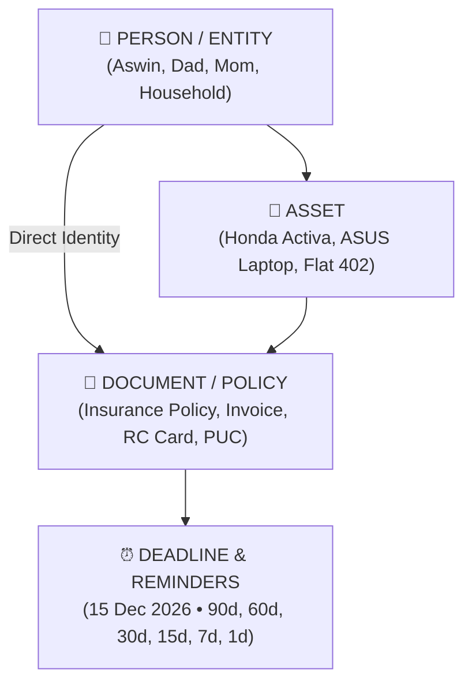
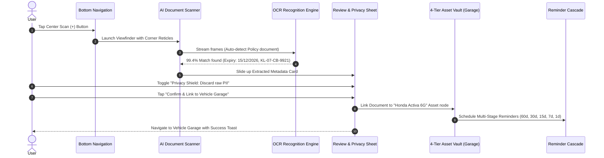
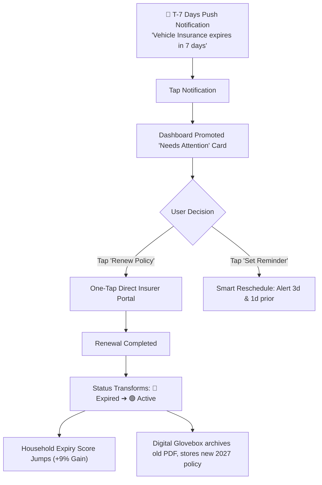
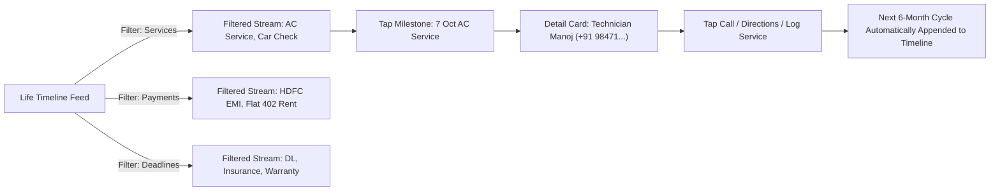
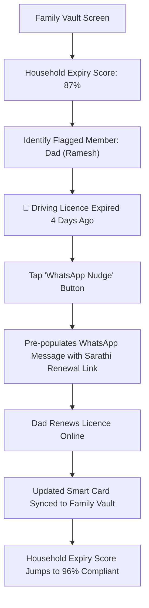

# 📐 ExpiryBox — Human-Crafted Light Design System & Spec

> **Product Vision**: *“One place to manage everything in your life that has a deadline, renewal, warranty, payment, or important document.”*  
> **Aesthetic Philosophy**: Warm paper whites, calm tactile surfaces, and subtle, non-neon status tones (crafted like *Notion, Things 3, and Apple Wallet*).

---

## 1. Human-Crafted Light Color Palette

Unlike synthetic, neon-heavy "AI dashboards", this system is built on **organic contrast, readability, and warm tactile neutrals**:

```
┌────────────────────────────────────────────────────────────────────────┐
│                   HUMAN LIGHT PALETTE MATRIX                           │
├─────────────────┬──────────┬──────────┬────────────────────────────────┤
│ Token Name      │ Hex Code │ RGB      │ Purpose / Figma Usage          │
├─────────────────┼──────────┼──────────┼────────────────────────────────┤
│ surface-canvas  │ #FAF9F6  │ 250,249,2│ Warm off-white paper canvas    │
│ surface-card    │ #FFFFFF  │ 255,255,2│ Pure white elevated card layer │
│ surface-subtle  │ #F3F4F6  │ 243,244,2│ Soft gray badge/input fill     │
│ border-default  │ #E5E7EB  │ 229,231,2│ Subtle 1px crisp divider       │
│                 │          │          │                                │
│ text-main       │ #111827  │ 17,24,39 │ Deep charcoal header & titles  │
│ text-body       │ #4B5563  │ 75,85,99 │ Slate body text                │
│ text-muted      │ #6B7280  │ 107,114,1│ Subtext, timestamps & tags     │
│                 │          │          │                                │
│ brand-primary   │ #111827  │ 17,24,39 │ Grounded black/charcoal CTA    │
│ brand-link      │ #2563EB  │ 37,99,235│ Subtle denim blue interactive  │
│                 │          │          │                                │
│ status-danger   │ #991B1B  │ 153,27,27│ 🔴 Rose Clay text (<7 days)    │
│ danger-bg       │ #FEF2F2  │ 254,242,2│ Rose Clay badge background     │
│ danger-border   │ #FEE2E2  │ 254,226,2│ Rose Clay badge border         │
│                 │          │          │                                │
│ status-warning  │ #92400E  │ 146,64,14│ 🟡 Warm Amber text (8-30 days) │
│ warning-bg      │ #FFFBEB  │ 255,251,2│ Warm Amber badge background    │
│ warning-border  │ #FEF3C7  │ 254,243,1│ Warm Amber badge border        │
│                 │          │          │                                │
│ status-success  │ #065F46  │ 6,95,70  │ 🟢 Eucalyptus text (>30 days)  │
│ success-bg      │ #ECFDF5  │ 236,253,2│ Eucalyptus badge background    │
│ success-border  │ #D1FAE5  │ 209,250,2│ Eucalyptus badge border        │
│                 │          │          │                                │
│ status-payment  │ #1E40AF  │ 30,64,175│ 🔵 Soft Denim Blue (EMIs/Rent) │
│ payment-bg      │ #EFF6FF  │ 239,246,2│ Denim Blue badge background    │
│                 │          │          │                                │
│ status-service  │ #5B21B6  │ 91,33,182│ 🟣 Soft Lilac (Maintenance)    │
│ service-bg      │ #F5F3FF  │ 245,243,2│ Lilac badge background         │
└─────────────────┴──────────┴──────────┴────────────────────────────────┘
```

---

## 2. Key Differences from "AI Templates"

| Element | Generic AI Aesthetic (Old) | Human-Crafted Aesthetic (Current) |
|:---|:---|:---|
| **Background** | Pitch black (`#0B0F19`), neon grids | Warm paper off-white (`#FAF9F6`), subtle canvas |
| **Status Colors** | Neon crimson (`#EF4444`), neon yellow | Natural Rose Clay (`#991B1B`) & Honey Amber (`#92400E`) |
| **Borders** | Glowing neon cyan outline | Subtle 1px warm zinc (`#E5E7EB`) |
| **Buttons** | High-saturation purple/indigo gradients | Tactile charcoal (`#111827`) with crisp white typography |
| **Camera Scanner** | Futuristic laser HUD, cyberpunk reticles | Clean document frame with corner guides, gentle blue scan |
| **Shadows** | Electric glow drop-shadows | Natural ambient elevation (`0 1px 3px rgba(0,0,0,0.06)`) |

---

## 3. The 4-Tier Relational Model



---

## 4. Vector Files Ready for Figma (Drag & Drop)

- **[`01_dashboard.svg`](file:///d:/MERN/ExpiryBox/figma-designs/svg/01_dashboard.svg)**
- **[`02_life_timeline.svg`](file:///d:/MERN/ExpiryBox/figma-designs/svg/02_life_timeline.svg)**
- **[`03_smart_ocr_scanner.svg`](file:///d:/MERN/ExpiryBox/figma-designs/svg/03_smart_ocr_scanner.svg)**
- **[`04_vehicle_garage.svg`](file:///d:/MERN/ExpiryBox/figma-designs/svg/04_vehicle_garage.svg)**
- **[`05_family_vault.svg`](file:///d:/MERN/ExpiryBox/figma-designs/svg/05_family_vault.svg)**
- **[`all_artboards_canvas.svg`](file:///d:/MERN/ExpiryBox/figma-designs/svg/all_artboards_canvas.svg)**
- **[`tokens.json`](file:///d:/MERN/ExpiryBox/figma-designs/tokens.json)**


---

## 6. End-to-End User Flow Architecture & Wireflows

### Flow 1: Smart Capture & AI OCR Link Flow


---

### Flow 2: Urgent Expiry Triage & Penalty Prevention Flow


---

### Flow 3: Life Timeline Milestone Discovery Flow


---

### Flow 4: Family Vault Collaborative Nudge Flow

